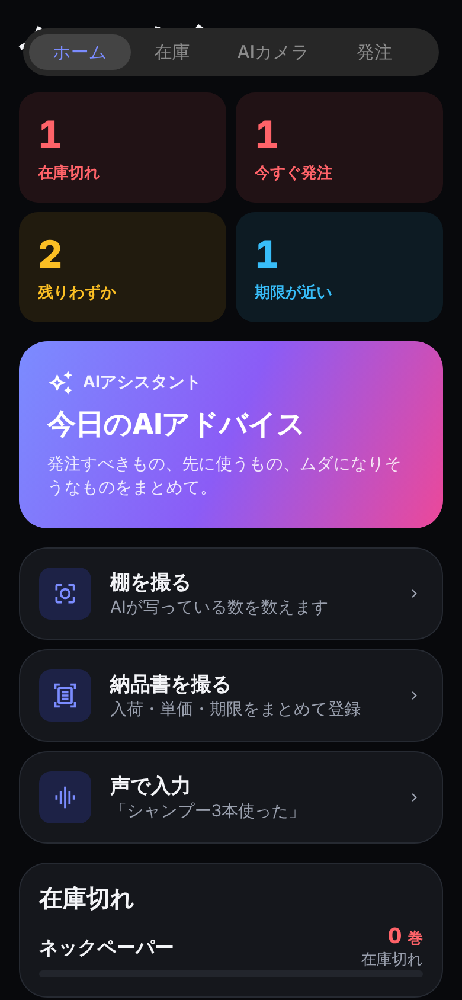
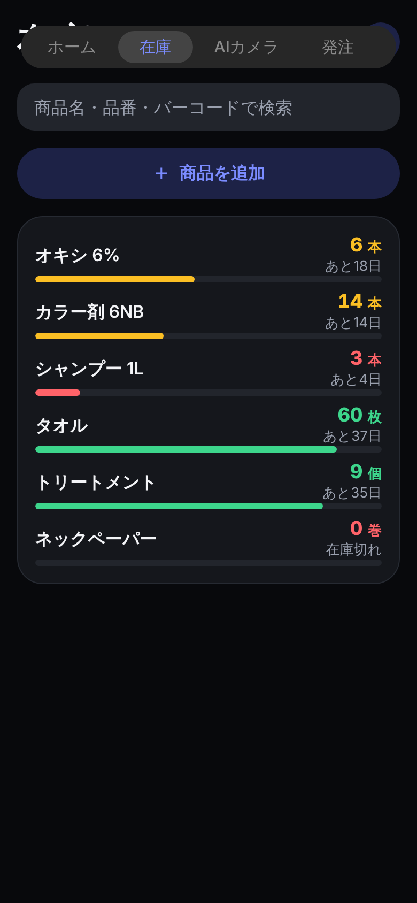
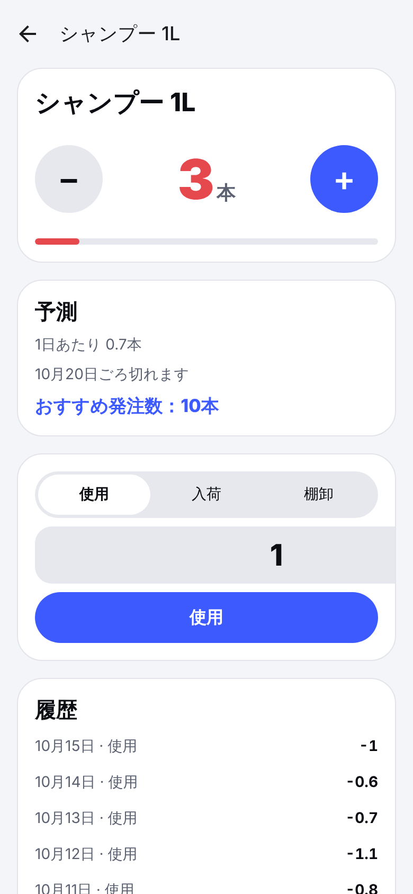
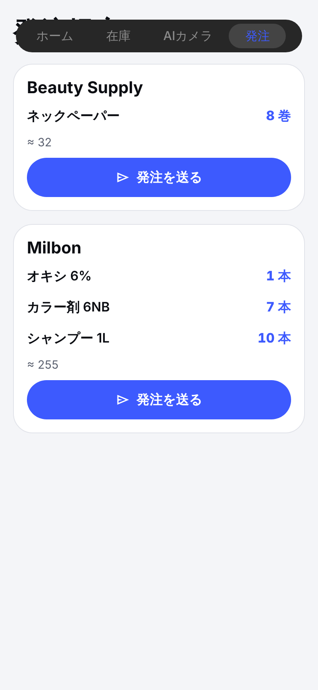

# StockPilot — AI在庫管理アプリ

飲食店・美容室・雑貨店・ファッション・薬局など、どの業種でも使えるiOS / Android向けの在庫管理アプリです。
棚を撮る、納品書を撮る、話しかける。それだけで在庫が更新され、切れる前にAIが発注を提案します。

| ホーム | 在庫 | 商品 | 発注 |
|---|---|---|---|
|  |  |  |  |

> スクリーンショットは確認用のWeb版です。iOS / Androidの実機では、下部のネイティブタブ、iOS 26のLiquid Glass、SF Symbolsで表示されます。

## 機能

**AI（Claude）**
- **棚を撮るだけで棚卸し**：写真から商品と個数を読み取り、既存の商品と自動で照合
- **納品書・レシートを撮って入荷**：商品・数量・単価・使用期限をまとめて登録
- **声で入力**：「シャンプー3本使った、タオル10枚入荷」→ 在庫操作に変換（8言語の音声認識）
- **AIアシスタント**：全商品の在庫・消費ペース・期限を把握した上で質問に回答。「今週何を発注？」「ムダになりそうなのは？」に答え、そのまま在庫操作も提案
- **今日のAIアドバイス**：ホームからワンタップで、発注・先に使うもの・リスクを要約
- AIの結果は必ず確認画面を通してから反映（自信が低い新商品は初期状態でチェックなし）

**その他**：在庫一覧をCSVで書き出し（Excelでそのまま開けます）、バーコード読み取りで商品を即表示／新規登録。

**自動化（端末内で即時計算）**
- 使用ペースの予測（指数平滑）、在庫切れ日の予測、おすすめ発注数（安全在庫込み）
- 発注点を設定しなくても、使用ペースから自動で学習
- 使用期限のある在庫は**先に切れるものから自動で消費**（FEFO）し、期限切れでムダになる量を予測
- 発注が必要なものを毎朝9時に自動通知
- 発注提案を仕入先ごとにまとめ、LINE・メールなどでそのまま送信

**業種ごとの最適化**：単位・期限管理・サイズ/色のバリエーション・発注サイクルを業種に合わせて自動設定。サンプルデータですぐ試せます。

**多言語**：日本語・English・ไทย・简体中文・한국어・Tiếng Việt・Bahasa Indonesia・Español（AIの返答も同じ言語）

## 技術

| | |
|---|---|
| アプリ | Expo SDK 58 / React Native 0.88 / React 19.3 + React Compiler / TypeScript 6 |
| 画面 | Expo Router（ネイティブタブ、formSheet、Protected routes）、iOS 26 Liquid Glass（`expo-glass-effect`）、SF Symbols / Material Symbols |
| アニメーション | Reanimated 4（CSSトランジション・キーフレーム、レイアウトアニメーション）、触覚フィードバック |
| データ | `expo-sqlite`（オフラインで動く端末内DB、WAL）|
| カメラ・音声 | `expo-camera`（撮影＋バーコード）、`expo-speech-recognition`（端末の音声認識）|
| AIサーバー | Cloudflare Workers + Hono、Claude API（`claude-opus-5-5`、構造化出力、プロンプトキャッシュ、拒否時の自動フォールバック）|

APIキーはアプリに入れず、`server/` のAIサーバーだけが持ちます。

## 収益化

| プラン | 価格（目安） | 内容 |
|---|---|---|
| 無料 | $0 | 100品目、AI 20回/月 |
| プロ | $14.99/月 | 品目無制限、AI 600回/月 |
| ビジネス | $49.99/月 | 品目無制限、AI 3000回/月、複数店舗（予定）|

AI回数の上限はサーバー側で端末ごとに管理します。プランはRevenueCatのWebhook（`/v1/webhooks/revenuecat`）で更新され、アプリから送られた値は信用しません。

購入画面（ペイウォール）・購入の復元はRevenueCat SDKで実装済みです。RevenueCatのキーが未設定のビルドでは購入ボタンが無効になり、その旨を表示します。

## 公開までのチェックリスト（アカウントが必要なもの）

コードは揃っています。残りは各サービスへの登録と鍵の設定です。

1. **Anthropic**：APIキーを発行 → AIサーバーに設定
2. **Cloudflare**（無料枠あり）：AIサーバーを公開（下記「1. AIサーバー」）
3. **Expo**：アカウント作成 → `npx eas-cli@latest init` でプロジェクトを紐づけ
4. **Apple Developer**（年$99）／**Google Play Console**（初回$25）：アプリを登録
5. **ストアのサブスク商品**：`pro_monthly` と `business_monthly`（商品IDに `pro` / `business` を含めれば自動で対応）
6. **RevenueCat**（売上$2.5k/月まで無料）：
   - エンタイトルメント `pro` と `business` を作り、上の商品を割り当て、Offeringを「current」に設定
   - Webhook を `https://<AIサーバー>/v1/webhooks/revenuecat` に向け、Authorizationヘッダーに `Bearer <REVENUECAT_WEBHOOK_SECRET>`
   - 公開SDKキーを `.env` の `EXPO_PUBLIC_RC_IOS_KEY` / `EXPO_PUBLIC_RC_ANDROID_KEY` に
7. **ビルドと申請**：`npx eas-cli@latest build -p all --profile production` → `npx eas-cli@latest submit`

## 動かし方

### 1. AIサーバー

```bash
cd server
npm install
npx wrangler secret put ANTHROPIC_API_KEY
npx wrangler secret put APP_KEY            # 好きな文字列（アプリと合わせる）
npx wrangler secret put REVENUECAT_WEBHOOK_SECRET
npx wrangler kv namespace create QUOTA     # 出力されたidを wrangler.toml に記入
npm run deploy
```

ローカルで試す場合は `server/.dev.vars` に `ANTHROPIC_API_KEY=...` と `APP_KEY=dev` を書いて `npm run dev`。

### 2. アプリ

```bash
npm install
cp .env.example .env    # EXPO_PUBLIC_AI_URL と EXPO_PUBLIC_APP_KEY を設定
npx expo run:ios        # または run:android（カメラ・音声・課金などネイティブ機能のため開発ビルドが必要）
# Macがない場合：npx eas-cli@latest build --profile development
```

ストア配信は EAS（`npx eas-cli@latest build`、`submit`）で、Macがなくてもクラウドでビルドできます。

### チェック

```bash
npm run typecheck && npm test && npx expo lint   # アプリ
cd server && npm run typecheck && npm test       # サーバー
```

## 構成

```
src/app/            画面（Expo Router）
  (tabs)/           ホーム・在庫・AIカメラ・発注・設定
  assistant.tsx     AIアシスタント
  review.tsx        AI結果の確認画面
  voice.tsx         音声入力
  item/             商品詳細・新規
  paywall.tsx       サブスク購入
src/lib/            予測・FEFO・プラン・多言語（純粋関数、テストあり）
src/db/             SQLite スキーマ・操作・サンプルデータ
src/ai/             AIサーバーとの通信
src/billing/        RevenueCat（購入・復元・プラン同期）
server/             AIサーバー（Cloudflare Workers + Claude）
```
